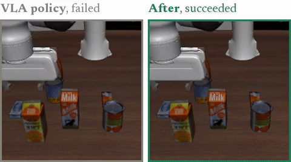
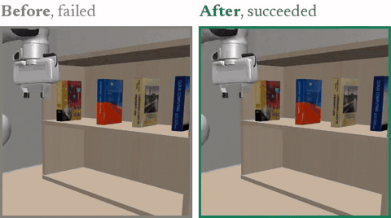
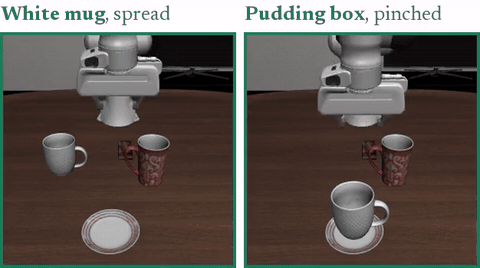
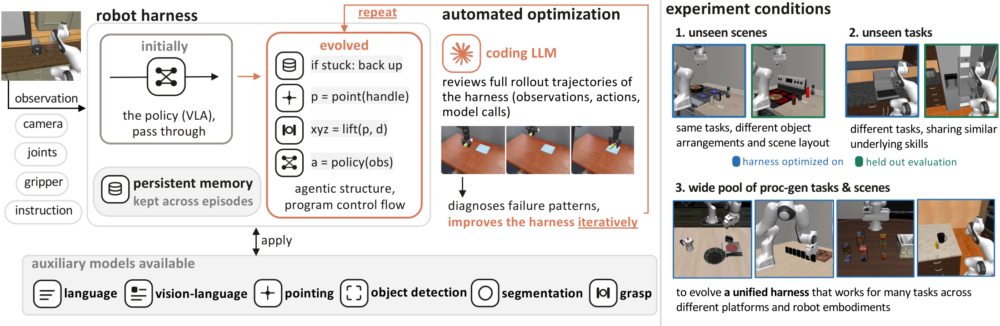

<div align="center">
<h1>RoboArchitect:<br>Automating the Design of Robotic Agents with Persistent Memory</h1>

[](https://roboarchitect-ai.github.io/)
[](https://arxiv.org/abs/2610.42141)
[](https://huggingface.co/papers/2610.42141)
[](https://x.com/ShengguangWu/status/2117406806284911001)

</div>

---

**RoboArchitect** studies the failures of a frozen robot policy and automatically designs and continually improves a robotic agent around it, without updating any model weights. A coding model observes the robot's rollouts, diagnoses failures, and iteratively refines the agent harness around the policy. The evolved agents dynamically combine the VLA policy with code-as-policy, design their own control routines, and keep a persistent memory across episodes. On held-out episodes across diverse setups, average success rises from 9.7% to 43.3% on unseen scenes and from 12.7% to 40.2% on unseen tasks.

<table>
<tr>
<td width="33%"></td>
<td width="33%"></td>
<td width="33%"></td>
</tr>
<tr>
<td><b>Control routine.</b> The VLA policy keeps driving into the juice carton until it tips over. The evolved agent compares the commanded and the actual gripper motion, and when they keep disagreeing, it lifts the arm clear before asking the policy again. <em>MolmoAct-2 on LIBERO-Pro-10.</em></td>
<td><b>Control routine.</b> With a fixed <b><em>top-down motion</em></b>, the robot hand always runs into the shelf board over the book. RoboArchitect adds a <b><em>horizontal approach</em></b>: the evolved agent finds the board in the depth image, turns the wrist flat and reaches in beneath it. <em>X-VLA on VLABench.</em></td>
<td><b>Persistent memory.</b> Across episodes, the memory counts how often each grip, pinch or spread, worked for each object, and later grasps reuse the proven one: the mug is <b><em>spread</em></b> from the inside and the pudding box is <b><em>pinched</em></b>. <em>OpenVLA-7B on LIBERO-Pro-10.</em></td>
</tr>
</table>

## Method

<p align="center">

</p>

RoboArchitect iteratively designs and refines an agent harness around a frozen robot policy (VLA). The harness starts by passing the policy's actions through unchanged. In each iteration, a coding model studies the recorded rollouts of the current agent (camera videos, a step-by-step trace of observations, actions and model calls, and the memory), diagnoses the failures, and designs a revised harness. Every revision is **grounded in concrete observations of the robot's behavior**. The new harness may follow the policy, call auxiliary models for language, vision, detection, segmentation, pointing and grasp poses, command the arm directly, or keep a **persistent memory** that carries experience across episodes. Over iterations, the agent improves continually. The final agent is then evaluated on held-out episodes that were never used to optimize it: unseen scenes or unseen tasks. RoboArchitect also evolves a single **unified agent across diverse robot platforms** (the Franka arm, the WidowX and the Google robot) on procedurally generated scenes and tasks.

Without any instruction on how to divide the work, most evolved agents **converge on a dynamic split between the VLA policy and code-as-policy**: the policy keeps the motions it executes well, and the code takes over where the policy fails, often handing control back once the failure is fixed.

## Setup

Build the environment that runs RoboArchitect and every agent harness (`harness` in `paths.json`):

```bash
conda create -n roboarchitect python=3.11
conda activate roboarchitect
pip install numpy msgpack pillow
```

RoboArchitect also needs `ffmpeg` on your `PATH` to write the rollout videos, and [Claude Code](https://github.com/anthropics/claude-code) (the `claude` command) to run the coding model.

Build each benchmark, policy and auxiliary model in its own Python environment by following its official guide, and add `msgpack` to each. Download the checkpoints your setup names (`policy.checkpoint` and `tools`) into your Hugging Face cache.

Copy `paths.example.json` to `paths.json`, replace each placeholder with the path of the environment you built, and delete the entries you do not use:

| Benchmark | `paths.json` | Repository |
|---|---|---|
| LIBERO-Pro | `libero_pro` | [Zxy-MLlab/LIBERO-PRO](https://github.com/Zxy-MLlab/LIBERO-PRO) |
| RoboCerebra | `robocerebra` | [buaa-colalab/RoboCerebra](https://github.com/buaa-colalab/RoboCerebra) |
| VLABench | `vlabench` | [OpenMOSS/VLABench](https://github.com/OpenMOSS/VLABench) |
| SimplerEnv | `simpler` | [simpler-env/SimplerEnv](https://github.com/simpler-env/SimplerEnv) with [X-VLA's changes](https://github.com/allenai/vla-evaluation-harness/blob/main/docker/Dockerfile.simpler_xvla) |
| RoboCasa-365 | `robocasa` | [robocasa/robocasa](https://github.com/robocasa/robocasa) |

- RoboCerebra also needs its benchmark folder: set the environment variable `ROBOCEREBRA_BENCH_ROOT` to it.

| Policy | `paths.json` | Repository | Checkpoint |
|---|---|---|---|
| X-VLA | `xvla` | [2toinf/X-VLA](https://github.com/2toinf/X-VLA) | [X-VLA-Pt](https://huggingface.co/2toINF/X-VLA-Pt), [X-VLA-Libero](https://huggingface.co/2toINF/X-VLA-Libero), [X-VLA-WidowX](https://huggingface.co/2toINF/X-VLA-WidowX), [X-VLA-Google-Robot](https://huggingface.co/2toINF/X-VLA-Google-Robot), [X-VLA-VLABench](https://huggingface.co/2toINF/X-VLA-VLABench) |
| π0.5 | `pi05` | [huggingface/lerobot](https://github.com/huggingface/lerobot) | [lerobot/pi05_libero_finetuned](https://huggingface.co/lerobot/pi05_libero_finetuned) |
| SmolVLA | `smolvla` | [huggingface/lerobot](https://github.com/huggingface/lerobot) | [lerobot/smolvla_robocerebra](https://huggingface.co/lerobot/smolvla_robocerebra) |
| RLinf-π0.5 | `rlinf_pi05` | [RLinf/RLinf](https://github.com/RLinf/RLinf) | [RLinf/RLinf-Pi05-LIBERO-130-fullshot-SFT](https://huggingface.co/RLinf/RLinf-Pi05-LIBERO-130-fullshot-SFT) |
| MolmoAct-2 | `molmoact2` | [allenai/molmoact2](https://github.com/allenai/molmoact2) | [allenai/MolmoAct2-LIBERO](https://huggingface.co/allenai/MolmoAct2-LIBERO) |
| OpenVLA-7B | `openvla` | [openvla/openvla](https://github.com/openvla/openvla) | [openvla/openvla-7b-finetuned-libero-10](https://huggingface.co/openvla/openvla-7b-finetuned-libero-10) |
| RLDX-1 | `rldx` | [RLWRLD/RLDX-1](https://github.com/RLWRLD/RLDX-1) | [RLWRLD/RLDX-1-FT-RC365](https://huggingface.co/RLWRLD/RLDX-1-FT-RC365) |

- SmolVLA also needs [HuggingFaceTB/SmolVLM2-500M-Video-Instruct](https://huggingface.co/HuggingFaceTB/SmolVLM2-500M-Video-Instruct), π0.5 also needs [google/paligemma-3b-pt-224](https://huggingface.co/google/paligemma-3b-pt-224), and RLDX-1 also needs [RLWRLD/RLDX-1-VLM](https://huggingface.co/RLWRLD/RLDX-1-VLM). Download these into your Hugging Face cache too.
- X-VLA and RLinf-π0.5 also need their repository folder: replace `<X_VLA_REPO_PATH>` and `<RLINF_REPO_PATH>` in `paths.json`.
- π0.5 and SmolVLA can share the LeRobot environment.

| Auxiliary model | Role | `paths.json` | Checkpoint |
|---|---|---|---|
| Qwen3-30B-A3B-Instruct | language | `language` | [Qwen/Qwen3-30B-A3B-Instruct-2507](https://huggingface.co/Qwen/Qwen3-30B-A3B-Instruct-2507) |
| Qwen3-VL-8B-Instruct | vision | `vision` | [Qwen/Qwen3-VL-8B-Instruct](https://huggingface.co/Qwen/Qwen3-VL-8B-Instruct) |
| Molmo2-8B | vision, pointing | `molmo2` | [allenai/Molmo2-8B](https://huggingface.co/allenai/Molmo2-8B) |
| Grounding DINO | detection | `grounding_dino` | [IDEA-Research/grounding-dino-base](https://huggingface.co/IDEA-Research/grounding-dino-base) |
| SAM 3 | segmentation | `sam3` | [AEmotionStudio/sam3](https://huggingface.co/AEmotionStudio/sam3) |
| GraspGen | grasp poses | `graspgen` | [adithyamurali/GraspGenModels](https://huggingface.co/adithyamurali/GraspGenModels) |

- SAM 3 and GraspGen load their checkpoints with the code from their own repositories, so install [facebookresearch/sam3](https://github.com/facebookresearch/sam3) and [NVlabs/GraspGen](https://github.com/NVlabs/GraspGen) in their environments. The other auxiliary models need an environment with `transformers` (see each model card) and their checkpoints.

## Running RoboArchitect

`python -m roboarchitect evolve --setup <setup> --split <split> --gpus <gpus> --out <folder>`:

1. evaluates the starting harness, [`roboarchitect/starting_harness.py`](roboarchitect/starting_harness.py), on the training episodes. By default, the starting harness passes the robot policy's actions through unchanged; start from another harness with `--starting-harness`.
2. gives the coding model (Claude Code with `claude-opus-5` by default; change the model with `--coding-model`) the current harness and the recorded rollouts of every episode, and the coding model designs a revised harness.
3. evaluates the revised harness on the training episodes, and keeps the revision only if it scores higher than the best harness so far.
4. repeats steps 2 and 3 for `--iterations` iterations (5 by default).
5. evaluates the starting harness and the final best harness on the held-out episodes.

| Argument | Meaning |
|---|---|
| `--setup` | the setup file: benchmark, policy, auxiliary models and score |
| `--split` | the split file: training and held-out episodes |
| `--gpus` | the GPUs to use; each runs one copy of each policy |
| `--episodes-per-gpu` | episodes run at the same time on each GPU (4 by default) |
| `--out` | the folder the experiment writes to |
| `--starting-harness`, `--coding-model`, `--iterations` | see steps 1, 2 and 4 above |

### Evolve a harness on training scenes, evaluate it on unseen scenes

```bash
python -m roboarchitect evolve \
    --setup setups/vlabench/xvla_pt.json \
    --split splits/scenes/vlabench.json \
    --gpus 0,1 \
    --out results/xvla_pt_vlabench_scenes
```

E.g., X-VLA on VLABench. The held-out episodes have the same tasks in other scene layouts.

### Evolve a harness on training tasks, evaluate it on unseen tasks

```bash
python -m roboarchitect evolve \
    --setup setups/libero_pro_10_swap/pi05.json \
    --split splits/tasks/libero_pro_10_swap.json \
    --gpus 0,1 \
    --out results/pi05_libero_pro_tasks
```

E.g., π0.5 on LIBERO-Pro-10. The held-out episodes are other tasks that need similar skills.

### Evolve a unified harness for several robots

```bash
python -m roboarchitect evolve \
    --setup setups/unified/xvla_pt.json \
    --split splits/unified.json \
    --gpus 0,1 \
    --out results/xvla_pt_unified
```

E.g., X-VLA on the Franka arm, the WidowX and the Google robot. The harness evolves on procedurally generated scenes, objects, instructions and tasks, and is evaluated on the standard episodes of LIBERO-Pro, SimplerEnv and VLABench. The training episodes in `splits/unified.json` are the ones we generated, provided for reference. You can generate your own. `setups/unified/xvla_specialists.json` does the same with the finetuned X-VLA checkpoints.

### To separately evaluate a harness

```bash
python -m roboarchitect evaluate \
    --setup setups/vlabench/xvla_pt.json \
    --split splits/scenes/vlabench.json \
    --harness results/xvla_pt_vlabench_scenes/final/harness/harness.py \
    --episodes held_out \
    --gpus 0,1 \
    --out results/xvla_pt_vlabench_check
```

This evaluates one harness, given with `--harness`, on the held-out episodes, or on the training episodes with `--episodes training`.

## Ready-made setups and splits

The above examples work with our provided episode splits for reference:

| Benchmark | `setups/` | Policies | `splits/` |
|---|---|---|---|
| LIBERO-Pro-10 | `libero_pro_10_swap/` | MolmoAct-2, OpenVLA-7B, π0.5, RLinf-π0.5, SmolVLA | `scenes/`, `tasks/` |
| RoboCerebra | `robocerebra/` | π0.5, SmolVLA | `scenes/`, `tasks/` |
| VLABench | `vlabench/` | X-VLA | `scenes/`, `tasks/` |
| SimplerEnv WidowX | `simpler_widowx/` | X-VLA | `scenes/`, `tasks/` |
| RoboCasa-365 | `robocasa365/` | RLDX-1 | `scenes/`, `tasks/` |
| LIBERO-Pro, SimplerEnv, VLABench | `unified/` | X-VLA, X-VLA finetuned on each benchmark | `unified.json` |

- `scenes/<benchmark>.json`: the held-out episodes have the training tasks in other scenes.
- `tasks/<benchmark>.json`: the held-out episodes have other tasks.
- `unified.json`: the training episodes are the ones we procedurally generated outside the evaluation set, provided for reference, and the held-out episodes are the benchmarks' standard ones.

You can customize all of these: write your own split with the episodes you choose, change the auxiliary models (`tools`) or the score (`metric`) in a setup file, and add a new policy (a class in `policies/`) or a new benchmark (a class in `benchmarks/`).

## Repository layout

```
roboarchitect/   the optimization loop, the evaluation, and the model servers
benchmarks/      simulator wrapper per benchmark, and the score functions
policies/        server per robot policy (VLA)
auxiliary/       server per auxiliary model
setups/          ready-made setups: a policy on a benchmark, with its auxiliary models and score
splits/          ready-made lists of training and held-out episodes
```

## Citation

```bibtex
@misc{wu2026roboarchitect,
      title={RoboArchitect: Automating the Design of Robotic Agents with Persistent Memory}, 
      author={Shengguang Wu and Suning Huang and Cherie Ho and Ria Doshi and Hao Zhu and Serena Yeung-Levy},
      year={2026},
      eprint={2610.42141},
      archivePrefix={arXiv},
      primaryClass={cs.RO},
      url={https://arxiv.org/abs/2610.42141}, 
}
```
